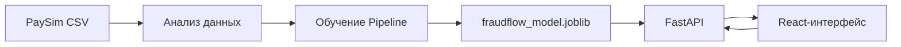

# FraudFlow

> Система обнаружения подозрительных финансовых транзакций на основе машинного обучения.


FraudFlow анализирует параметры транзакции, рассчитывает оценку риска и сравнивает её с порогом, выбранным на валидационной выборке. Проект объединяет полный ML-процесс: исследование данных, обучение модели, сохранение артефакта, API и пользовательский интерфейс.

## Возможности

- обучение модели на синтетическом финансовом датасете PaySim;
- временное разделение данных на обучение, валидацию и тест;
- обработка числовых и категориальных признаков через `Pipeline`;
- подбор порога обнаружения по максимальному F1 на валидации;
- сохранение модели, порога, версии и списка признаков в `.joblib`;
- проверка одной транзакции через FastAPI;
- просмотр всех 6 362 620 операций PaySim с пагинацией;
- зелёно-белый React-интерфейс с формой Risk Check и аналитикой.

## Как устроена система



1. `train_model.py` загружает PaySim и обучает модель.
2. Обученный Pipeline и его настройки сохраняются в `artifacts/fraudflow_model.joblib`.
3. `api.py` загружает артефакт один раз при запуске сервера.
4. React-интерфейс отправляет транзакции в API и показывает результат модели.

## Данные и признаки

Проект использует [PaySim](https://www.kaggle.com/datasets/ealaxi/paysim1) — синтетический датасет мобильных финансовых операций.

Входные признаки модели:

| Признак | Назначение |
|---|---|
| `step` | Временной шаг операции |
| `type` | Тип транзакции |
| `amount` | Сумма операции |
| `oldbalanceOrg` | Баланс отправителя до операции |
| `newbalanceOrig` | Баланс отправителя после операции |
| `oldbalanceDest` | Баланс получателя до операции |
| `newbalanceDest` | Баланс получателя после операции |

Целевая переменная — `isFraud`. Поле `isFlaggedFraud` не используется как входной признак, поскольку оно представляет результат существующего правила обнаружения.

Данные разделяются по времени:

| Выборка | Значения `step` |
|---|---:|
| Обучение | 1–520 |
| Валидация | 521–631 |
| Тест | 632–743 |

## Модель

В основе FraudFlow находится логистическая регрессия:

- `OneHotEncoder` обрабатывает тип операции;
- `StandardScaler` масштабирует числовые признаки;
- `LogisticRegression` использует `class_weight="balanced"`;
- решатель `newton-cholesky` подходит для большого количества строк и небольшого числа признаков;
- все преобразования объединены в единый scikit-learn `Pipeline`.

Выбранный порог: `0.9931289828`.

### Результаты на тестовой выборке

| Метрика | Результат |
|---|---:|
| Precision | **88.01%** |
| Recall | **56.31%** |
| F1 | **68.68%** |
| Average Precision | **76.35%** |

Матрица ошибок:

```text
[[88118    96]
 [  547   705]]
```

- 705 мошеннических операций обнаружено;
- 547 мошеннических операций пропущено;
- 96 обычных операций отмечено ошибочно;
- 88 118 обычных операций классифицировано правильно.

## Структура проекта

```text
FraudFlow/
├── api.py                 # FastAPI и доступ к модели
├── train_model.py         # обучение, оценка и сохранение модели
├── data_analysis.py       # исследовательский анализ PaySim
├── artifacts/             # локальные артефакты модели
├── data/                  # локальный CSV PaySim
└── fraudflow-ui/          # React + TypeScript интерфейс
    ├── src/
    │   ├── App.tsx
    │   ├── RiskCheck.tsx
    │   └── TransactionsPage.tsx
    └── package.json
```

## Установка

### 1. Python-окружение

```powershell
py -m venv .venv
.\.venv\Scripts\Activate.ps1
python -m pip install pandas numpy scikit-learn joblib fastapi pydantic "uvicorn[standard]"
```

### 2. Датасет

Скачайте PaySim и поместите CSV по адресу:

```text
data/PS_20174392719_1491204439457_log.csv
```

Папка `data/` исключена из Git, поскольку датасет имеет большой размер.

### 3. Обучение модели

```powershell
python train_model.py
```

После обучения будет создан файл:

```text
artifacts/fraudflow_model.joblib
```

### 4. Запуск API

```powershell
python -m uvicorn api:app --host 127.0.0.1 --port 8000 --reload
```

- Swagger: <http://127.0.0.1:8000/docs>
- Health check: <http://127.0.0.1:8000/health>

### 5. Запуск интерфейса

В новом терминале:

```powershell
cd fraudflow-ui
npm install
npm run dev -- --host 127.0.0.1 --port 5173
```

Интерфейс: <http://127.0.0.1:5173/>

## API

| Метод | Путь | Назначение |
|---|---|---|
| `GET` | `/health` | Проверка API и версии модели |
| `GET` | `/transactions` | Постраничное чтение PaySim |
| `POST` | `/predict` | Проверка одной транзакции моделью |

Пример запроса к `/predict`:

```json
{
  "step": 1,
  "type": "TRANSFER",
  "amount": 181.0,
  "oldbalanceOrg": 181.0,
  "newbalanceOrig": 0.0,
  "oldbalanceDest": 0.0,
  "newbalanceDest": 0.0
}
```

Пример ответа:

```json
{
  "fraud_score": 0.7723846834,
  "threshold": 0.9931289828,
  "is_fraud": false,
  "model_version": "1.0"
}
```

## Интерфейс

- **Overview** — обзор демонстрационных показателей;
- **Transactions** — просмотр полного датасета по семь операций на страницу;
- **Risk Check** — отправка транзакции в ML-модель;
- **Analytics** — итоговые метрики и аналитические блоки;
- **Settings** — настройки интерфейса.

## Ограничения

- PaySim содержит синтетические, а не реальные банковские операции.
- `fraud_score` является оценкой модели, а не гарантированной вероятностью мошенничества.
- Решение модели не должно использоваться как единственное основание для блокировки платежа.
- API и интерфейс настроены для локальной разработки.
- Файлы `.joblib` следует загружать только из доверенного источника.

## Следующее развитие

- хранение транзакций в базе данных;
- фильтрация и поиск по полному датасету;
- журнал проверок и история решений;
- авторизация пользователей;
- контейнеризация через Docker;
- мониторинг качества модели и повторное обучение.

---

FraudFlow предназначен для изучения полного цикла разработки ML-системы: от данных до работающего интерфейса.
