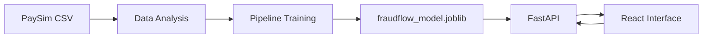

# FraudFlow

> A machine learning system for detecting suspicious financial transactions.


FraudFlow analyzes transaction attributes, calculates a fraud risk score, and compares it with a threshold selected on the validation set. The project covers the complete ML workflow: data exploration, model training, artifact persistence, API serving, and a user interface.

## Features

- Model training on the synthetic PaySim financial dataset
- Time-based train, validation, and test splits
- Numerical and categorical preprocessing with a scikit-learn `Pipeline`
- Detection-threshold selection by maximum validation F1 score
- Model, threshold, version, and feature-list persistence in a `.joblib` artifact
- Single-transaction prediction through FastAPI
- Paginated access to all 6,362,620 PaySim transactions
- Responsive green-and-white React interface with Risk Check and analytics views

## System Architecture



1. `train_model.py` loads PaySim and trains the model.
2. The fitted pipeline and its settings are saved to `artifacts/fraudflow_model.joblib`.
3. `api.py` loads the artifact once when the server starts.
4. The React interface sends transactions to the API and displays model results.

## Dataset and Features

FraudFlow uses [PaySim](https://www.kaggle.com/datasets/ealaxi/paysim1), a synthetic dataset of mobile financial transactions.

Model input features:

| Feature | Description |
|---|---|
| `step` | Transaction time step |
| `type` | Transaction type |
| `amount` | Transaction amount |
| `oldbalanceOrg` | Sender balance before the transaction |
| `newbalanceOrig` | Sender balance after the transaction |
| `oldbalanceDest` | Recipient balance before the transaction |
| `newbalanceDest` | Recipient balance after the transaction |

The target variable is `isFraud`. The `isFlaggedFraud` field is not used as an input because it represents the result of an existing detection rule.

The data is split chronologically:

| Split | `step` range |
|---|---:|
| Training | 1–520 |
| Validation | 521–631 |
| Test | 632–743 |

## Model

FraudFlow uses logistic regression:

- `OneHotEncoder` processes the transaction type.
- `StandardScaler` scales the numerical features.
- `LogisticRegression` uses `class_weight="balanced"`.
- The `newton-cholesky` solver is suitable for many rows and a small feature set.
- All preprocessing and classification steps are combined in one scikit-learn `Pipeline`.

Selected decision threshold: `0.9931289828`.

### Test Results

| Metric | Result |
|---|---:|
| Precision | **88.01%** |
| Recall | **56.31%** |
| F1 score | **68.68%** |
| Average Precision | **76.35%** |

Confusion matrix:

```text
[[88118    96]
 [  547   705]]
```

- 705 fraudulent transactions were detected.
- 547 fraudulent transactions were missed.
- 96 normal transactions were incorrectly flagged.
- 88,118 normal transactions were classified correctly.

## Project Structure

```text
FraudFlow/
├── api.py                 # FastAPI application and model access
├── train_model.py         # Model training, evaluation, and persistence
├── data_analysis.py       # Exploratory analysis of PaySim
├── artifacts/             # Local model artifacts
├── data/                  # Local PaySim CSV file
└── fraudflow-ui/          # React and TypeScript interface
    ├── src/
    │   ├── App.tsx
    │   ├── RiskCheck.tsx
    │   └── TransactionsPage.tsx
    └── package.json
```

## Installation

### 1. Create the Python environment

```powershell
py -m venv .venv
.\.venv\Scripts\Activate.ps1
python -m pip install pandas numpy scikit-learn joblib fastapi pydantic "uvicorn[standard]"
```

### 2. Add the dataset

Download PaySim and place the CSV file at:

```text
data/PS_20174392719_1491204439457_log.csv
```

The `data/` directory is excluded from Git because the dataset is large.

### 3. Train the model

```powershell
python train_model.py
```

Training creates the following artifact:

```text
artifacts/fraudflow_model.joblib
```

### 4. Start the API

```powershell
python -m uvicorn api:app --host 127.0.0.1 --port 8000 --reload
```

- Swagger UI: <http://127.0.0.1:8000/docs>
- Health check: <http://127.0.0.1:8000/health>

### 5. Start the interface

Open a second terminal:

```powershell
cd fraudflow-ui
npm install
npm run dev -- --host 127.0.0.1 --port 5173
```

Open the interface at <http://127.0.0.1:5173/>.

## API

| Method | Endpoint | Purpose |
|---|---|---|
| `GET` | `/health` | Check API status and model version |
| `GET` | `/transactions` | Read PaySim transactions page by page |
| `POST` | `/predict` | Evaluate one transaction with the model |

Example `/predict` request:

```json
{
  "step": 1,
  "type": "TRANSFER",
  "amount": 181.0,
  "oldbalanceOrg": 181.0,
  "newbalanceOrig": 0.0,
  "oldbalanceDest": 0.0,
  "newbalanceDest": 0.0
}
```

Example response:

```json
{
  "fraud_score": 0.7723846834,
  "threshold": 0.9931289828,
  "is_fraud": false,
  "model_version": "1.0"
}
```

## Interface

- **Overview** — summary dashboard with demonstration activity data
- **Transactions** — access to the complete dataset, seven rows per page
- **Risk Check** — submit a transaction to the ML model
- **Analytics** — model metrics and analytical components
- **Settings** — local interface preferences

## Limitations

- PaySim contains synthetic rather than real banking transactions.
- `fraud_score` is a model score, not a guaranteed fraud probability.
- A model prediction should not be the sole reason for blocking a payment.
- The API and interface are configured for local development.
- `.joblib` files should only be loaded from trusted sources.

## Future Improvements

- Store transactions in a database.
- Add full-dataset filtering and search.
- Keep prediction history and an audit log.
- Add user authentication.
- Containerize the application with Docker.
- Monitor model quality and support retraining.

---

FraudFlow demonstrates the complete lifecycle of an ML system, from raw data to an interactive application.
